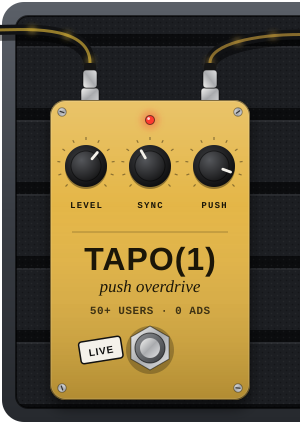
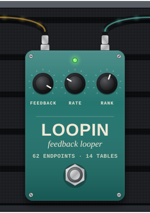
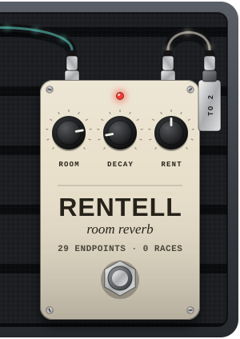
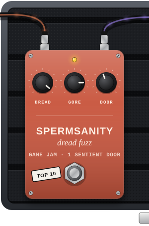
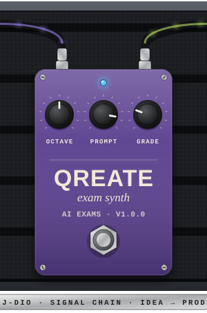
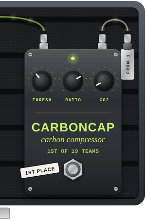
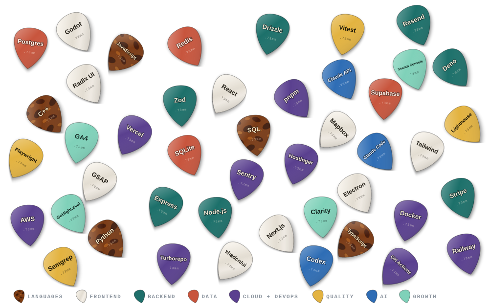

  

hey, I'm Dio. I study CS at UP Cebu and work two jobs at once. I'm a full-stack engineer at Off Grid VIP LLC, and at a UK startup I do web dev, IT support and project management.

I look for the friction in someone's day first, then build the software that removes it. I like shipping it to real users and then keeping it alive, which is usually the harder part.

[portfolio](https://lumacang-dio.vercel.app) &nbsp;·&nbsp; [linkedin](https://www.linkedin.com/in/john-dio-a-lumacang/) &nbsp;·&nbsp; [email](mailto:tcshs.lumacang.johndio.a@gmail.com)

 

### The board

One pedal per project, wired from idea to production: along the top tier, then back along the bottom. Click a pedal to open it.

[TapO(1)](https://tap-o1.vercel.app) pulls your Google Classroom and Moodle tasks into one list. It has 50+ users and I've never paid for an ad. I wrote the Web Push by hand inside a Deno edge function with zero Node dependencies, and if one of the two sources goes down, the other still syncs.

[LoopIn](https://github.com/j-dio/loop-in) is a place for indie apps to get found and get feedback. The API has 62 endpoints. It does OAuth with rotating refresh tokens, rate limiting through a Lua script in Redis, and Gemini ranks the feedback backlog.

[RenTell](https://rentell.vercel.app) lists student housing and carinderias (small local eateries). When two people open the same conversation at the same moment, Postgres sorts it out and you still end up with one chat.

CarbonCap is a Qt 6 desktop app for tracking your carbon footprint. It won 1st place out of 19 teams at the UP Cebu Project Expo 2025.

[Qreate](https://github.com/j-dio/Qreate) is an Electron app that turns your study notes into practice exams with AI. It's at v1.0.0.

[SpermSanity](https://github.com/j-dio/sperm-lovers) is a game jam entry for The Path Less Taken, a dark comedy about existential dread, reproductive biology and a sentient flesh door named Doorethy. It placed top 10.

### My picks

The tools I reach for most, colored by what they're for.

  

 

  Cebu, Philippines · the graphics here are SVGs made by <a href="./scripts/build.mjs">scripts/build.mjs</a>

